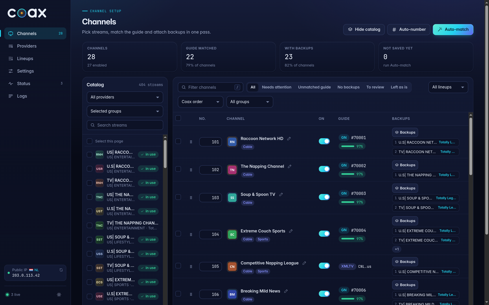
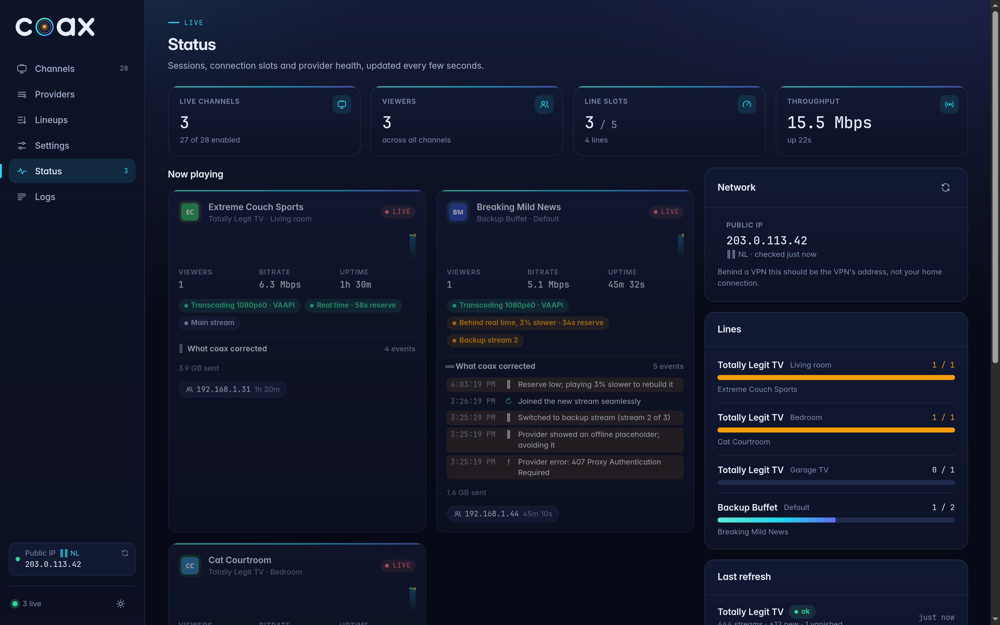
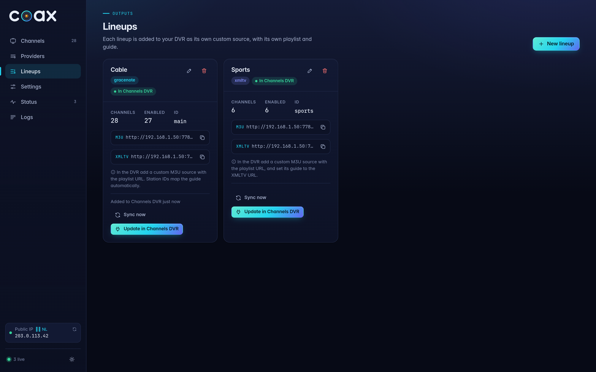
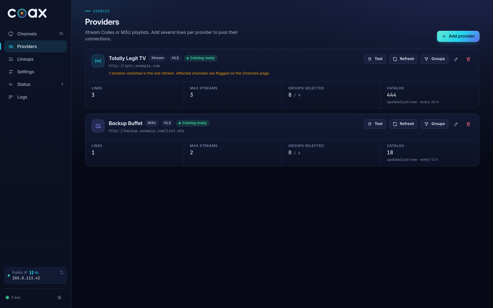
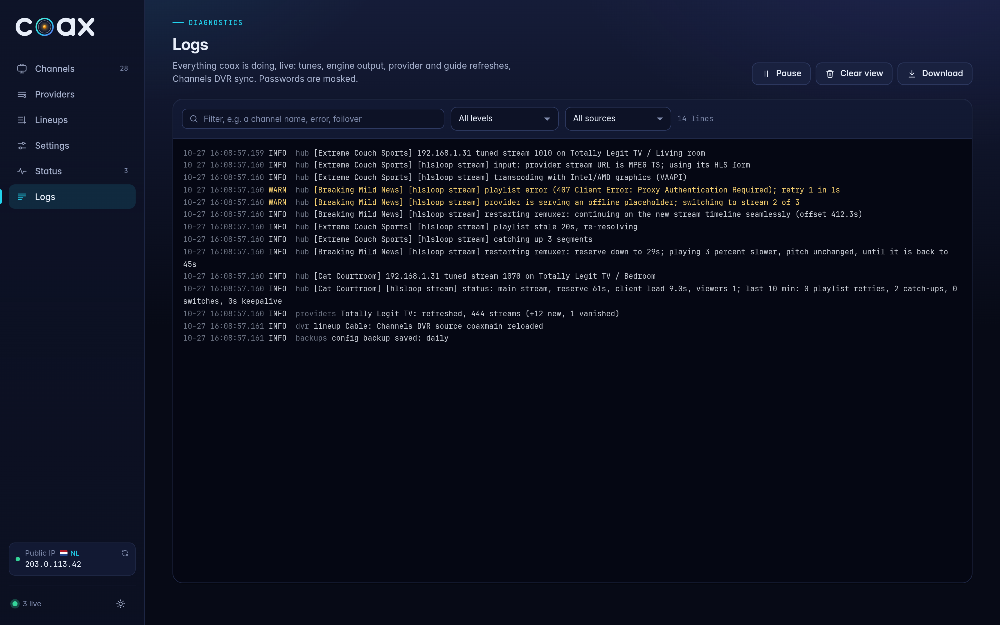
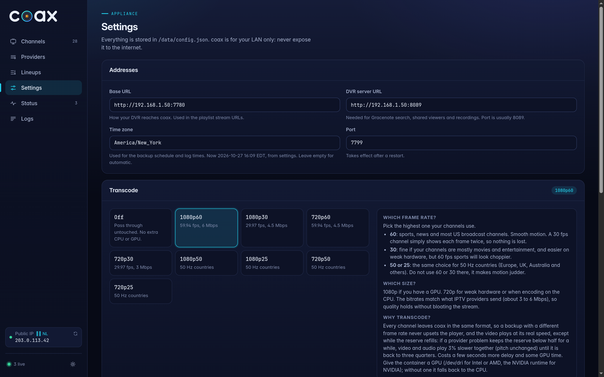

<h1 align="center">
  <picture>
    <source media="(prefers-color-scheme: dark)" srcset="assets/brand/coax-wordmark-dark.svg">
    <source media="(prefers-color-scheme: light)" srcset="assets/brand/coax-wordmark-light.svg">
    
  </picture>
</h1>

> **Not affiliated with Fancy Bits, LLC.** coax is an independent, unofficial project. It is not affiliated with, endorsed by, sponsored by, or supported by Fancy Bits, LLC or Channels DVR. Fancy Bits and Channels DVR will not provide support for coax; please do not contact them about it. Channels DVR is a trademark of Fancy Bits, LLC. All other trademarks and product names are the property of their respective owners and are used here only to describe compatibility.

coax is designed specifically for [Channels DVR](https://getchannels.com/). It is a small,
self-hosted IPTV appliance: you give it your IPTV playlists (Xtream Codes logins or M3U URLs), and it gives
your DVR a steady tuner stream for each channel, an M3U with Gracenote station IDs, and an optional XMLTV
guide.

It does one job and is built once: no auto-update, no code downloaded at runtime, no telemetry, no database.
Everything you set lives in one folder, `./data`.

> **LAN only.** coax has no login and no authentication. Your provider passwords are in its config. Never
> expose port 7780 to the internet (no port forwarding, no public reverse proxy). Use it on your home network,
> or reach it remotely through a VPN such as Tailscale or WireGuard.


## Screenshots

Channel names, providers and logos below are made up for the demo.

| | |
|---|---|
|  |  |
| **Channels**: pick streams, match the guide and attach backups in one pass | **Status**: live channels, transcoding, real-time and reserve, and what coax corrected |
|  |  |
| **Lineups**: one Channels DVR source each, added with one click | **Providers**: Xtream or M3U, several lines, group picker |
|  |  |
| **Logs**: live, filterable | **Settings**: addresses, transcoding, Auto-match region, backups |

## Contents

- [Features](#features)
- [Run it without a VPN](#run-it-without-a-vpn)
- [Run it with a VPN (Gluetun)](#run-it-with-a-vpn-gluetun)
- [First run](#first-run)
- [Settings reference](#settings-reference)
- [How playback stays smooth](#how-playback-stays-smooth)
- [HLS or MPEG-TS](#hls-or-mpeg-ts)
- [Recordings](#recordings)
- [GPU transcoding](#gpu-transcoding)
- [Updating](#updating)
- [Data folder](#data-folder)
- [Troubleshooting](#troubleshooting)
- [Building from source](#building-from-source)

## Features

- **Xtream Codes and M3U providers**, several side by side, with test connection and scheduled refresh.
- **Group selection** like Dispatcharr: pick which provider groups to bring in from a searchable checklist.
- **Connection pools**: several lines (logins) per provider, each with its own max streams. A tune takes the
  first stream of the channel that has a free line, across providers.
- **Backup streams per channel**, mixed across providers, with automatic failover in the stream engine and
  suggested matches (same name, call sign, or provider guide ID).
- **Tuner sharing**: a second viewer of the same channel shares the running stream and uses no extra line.
- **Never gives up on a stream.** While Channels DVR is connected, coax keeps recovering: a frozen engine is
  restarted, a stream with no video is retuned (alternating to another free line of the provider when there is one),
  and null packets hold the connection open in between, so a recording keeps going. Streams that failed recently
  are tried last, and each channel's 10-minute health lines are kept in `data/cache/history/`.
- **One-click Add to Channels DVR**: each lineup becomes a Channels DVR source with your choice of guide data,
  stream limit, numbering and logos. **Automatic sync** pushes every later change to the DVR within seconds and
  downloads the guide when it changes, so you never press *Refresh* in Channels DVR.
- **Gracenote guide data** through Channels DVR's own station search, with one-click suggestions, or
  **XMLTV** from your provider.
- **Transcoding (recommended)** to one fixed format (1080p or 720p, 60/30/50/25 fps) on Intel or AMD graphics
  (VAAPI), NVIDIA (NVENC), or the CPU.
- **Optional VPN** for all provider traffic using Gluetun.
- A web UI with a live Status page: sessions, viewers, line usage, throughput, and the log.

**User agent.** coax always identifies itself to providers as `TiviMate/5.1.6 (Android 12)`. This is
hard-coded and the same for every provider; it is not a setting.

## Run it without a VPN

You need Docker with Docker Compose on a machine on the same network as your Channels DVR server.

```sh
mkdir coax && cd coax
curl -fLO https://raw.githubusercontent.com/mackid1993/coax/main/docker-compose.yml
curl -fL https://raw.githubusercontent.com/mackid1993/coax/main/.env.example -o .env
# optional: edit .env (port, timezone)
docker compose up -d
```

Open `http://<this-host>:7780` and continue with [First run](#first-run).

Docker creates `./data` on first start. If it ends up owned by root, coax fixes that itself: the container
starts as root only long enough to `chown` `/data` to uid 1000, then runs coax as uid 1000.

The compose file uses `ghcr.io/mackid1993/coax:latest`, the newest release. Every release is also tagged
with its version number (for example `:1.0.0`) if you want to freeze one. Images are only built and published when the maintainer runs the release workflow by hand.

## Run it with a VPN (Gluetun)

`docker-compose.vpn.yml` runs [Gluetun](https://github.com/qdm12/gluetun) (MIT license, by qdm12) on its `latest` tag, and puts coax in Gluetun's network, so all of coax's traffic (provider logins, playlists, guides,
streams) goes through your VPN. If the tunnel drops, Gluetun blocks traffic rather than leaking it, and
streams stop until it reconnects.

```sh
mkdir -p coax && cd coax
curl -fLO https://raw.githubusercontent.com/mackid1993/coax/main/docker-compose.vpn.yml
curl -fL https://raw.githubusercontent.com/mackid1993/coax/main/.env.vpn.example -o .env
chmod 600 .env
# edit .env: your VPN values and LAN_SUBNETS
docker compose -f docker-compose.vpn.yml up -d
```

What to set:

1. **VPN settings.** Gluetun is set up entirely with environment variables and builds the tunnel itself;
   there are no config files to mount. The compose file has two examples; use one:
   - **WireGuard** (active by default): Gluetun's custom provider, which works with any WireGuard VPN. Put
     `WG_ENDPOINT_IP`, `WG_ENDPOINT_PORT`, `WG_PUBLIC_KEY`, `WG_PRIVATE_KEY`, `WG_ADDRESSES`, and
     `WG_PRESHARED_KEY` if your provider uses one, in a `.env` file next to the compose file. See Gluetun's
     [custom provider page](https://github.com/qdm12/gluetun-wiki/blob/main/setup/providers/custom.md).
   - **OpenVPN** (commented out): a built-in provider with your VPN login. Comment out the WireGuard block,
     uncomment the OpenVPN one, and put `VPN_PROVIDER`, `OPENVPN_USER`, `OPENVPN_PASSWORD` and
     `SERVER_COUNTRIES` in `.env`.
   Keep `.env` private (`chmod 600 .env`). `.env.vpn.example` lists every value with where to find it.
2. **`LAN_SUBNETS`** in `.env`: your LAN, for example `192.168.1.0/24`, passed to Gluetun as
   `FIREWALL_OUTBOUND_SUBNETS`. Without it Gluetun's firewall blocks the LAN and coax cannot reach Channels
   DVR. It must not overlap the VPN's own address range.
   To use one of Gluetun's built-in providers instead (Mullvad, ProtonVPN, and many more), replace the
   `gluetun` environment with the settings from your provider's page in the
   [provider setup list](https://github.com/qdm12/gluetun-wiki/tree/main/setup/providers).
3. **Ports.** coax shares Gluetun's network, so port 7780 is published on the `gluetun` service, not on
   `coax`.

Everything else about Gluetun (options, health checks, troubleshooting) is in the
[Gluetun wiki](https://github.com/qdm12/gluetun-wiki).

## First run

1. **Settings.** Set the *Base URL* to the address your DVR uses to reach coax, for example
   `http://192.168.1.50:7780` (use the host's LAN IP, not `localhost`). Set the *Channels DVR URL*, for example
   `http://192.168.1.60:8089`. It is used for Gracenote search and for the stream engine.
2. **Providers.** Add a provider:
   - *Xtream Codes*: the server URL (`http://host:port`) and a username and password.
   - *M3U*: the playlist URL, and optionally an XMLTV URL.

   Press *Test connection*.
3. **Lines.** Add one line per login you have with that provider and set *max streams* to what your plan
   allows (0 means unlimited, for M3U sources without a limit). If you have three logins on one service, add
   three lines; coax spreads tunes across them.
4. **Groups.** coax fetches the provider's live groups. Tick the ones you want (search helps with large
   lists). Only streams in these groups are offered when adding channels. Optionally turn on *auto add* to
   add new streams in those groups as disabled channels at each refresh.
5. **Channels.** Browse and filter the streams, select the ones you want, and add them as channels. Number
   and reorder them, attach backup streams (from any provider), and enable or disable channels.
6. **Guide.** For each channel choose a guide mode:
   - **Gracenote**: coax searches Channels DVR's station database and suggests the best match with a
     confidence score. Channels DVR then uses its own guide data for that channel. Best when it matches.
   - **XMLTV**: use the provider's guide for that channel; pick the XMLTV channel id from the list.
   - **Both**: the Gracenote station id, with XMLTV as the fallback for channels that have none.
   - **None**: no guide data.
7. **Lineups.** A default lineup holds all channels. Add more lineups if you want separate sources in the
   DVR (for example kids or sports).
8. **Add each lineup to Channels DVR.** On the *Lineups* page, press **Add to Channels DVR** on a lineup and
   pick:
   - **Guide data**: Gracenote, XMLTV, or Gracenote with XMLTV as the fallback.
   - **Stream limit**: how many channels the DVR may tune at once (coax suggests your providers' total).
   - **Channel numbers**: use coax's numbers, or let Channels DVR number them from a start you choose.
   - **Channel logos**: coax's logos or the guide's.
   - **Source name**: how it appears in the DVR's Sources list.

   coax creates the custom source in Channels DVR for you (MPEG-TS, coax's M3U and XMLTV addresses), loads its
   channels and starts a guide download. You do not need to open Channels DVR's settings.

   **It stays in sync on its own.** After that, every change you make in coax (adding, removing, renaming or
   renumbering channels, new guide matches, logos) is pushed to Channels DVR a few seconds later: coax refreshes
   the source and, when channels or guide ids changed, downloads the guide again. There is no *Refresh* button to
   press in Channels DVR. *Sync now* on the lineup card forces it, and the card shows when it last synced.

   To add a source by hand instead (for example on another DVR), use *Custom Channels* with stream format
   **MPEG-TS**, the source URL `http://<coax-host>:7780/output/m3u/<lineup>.m3u`, and, for XMLTV guide data,
   `http://<coax-host>:7780/output/xmltv/<lineup>.xml`. A source added by hand is not kept in sync.

The *Status* page shows live sessions, viewers, which line each channel holds, refresh results, and the log.

## Settings reference

| Setting | What it does |
| --- | --- |
| Base URL | The address written into the M3U stream links. Must be reachable from the DVR. |
| Channels DVR URL | Your DVR, `http://IP:8089`. Used for Gracenote search and the viewer buffer. |
| Transcode | One fixed format such as `1080p60` (recommended), or `off` to pass streams through (the default). See [GPU transcoding](#gpu-transcoding). |
| Provider refresh hours | How often each provider's catalog is refreshed. A failed refresh keeps the last good catalog. |

## How playback stays smooth

IPTV feeds are uneven. Segments arrive late, a provider stalls, refuses a request, restarts a channel, or
swaps a dead channel for a black "offline" clip. coax's stream engine absorbs this so Channels DVR gets a
steady stream at real time, the way an HDMI encoder delivers one. Every tune runs its own engine process on
one provider line; the engine holds the cushion and the hub keeps the connection alive around it.

### The reserve

- **The cushion lives in coax, not in the players.** On HLS the engine joins about 60 seconds back in the
  provider's playlist (at least 3 segments, or the whole playlist if it is shorter), so you watch about a
  minute behind live. It sends about 4 seconds ahead to Channels DVR and keeps the rest as its reserve. On
  MPEG-TS the reserve is the burst of recent video the provider sends on connect, usually about 20 seconds.
- **When the provider is late,** the reserve keeps video flowing. When it catches up, HLS downloads the
  segments it missed and the reserve refills.
- **Paced by timestamps.** Video leaves coax at exactly real time, timed by each frame's timestamp rather
  than by bytes, including through a switch to a backup with a different bitrate or frame rate.
- **A drained reserve.** If the provider falls behind for longer than the reserve covers, the log shows
  `reserve: empty` (HLS) or `reserve empty` (MPEG-TS), and video arrives only as fast as the provider sends
  it. This is the line that matches visible buffering. With transcoding off, the HLS reserve comes back on
  a retune, and the MPEG-TS reserve through a fresh connection's burst. With transcoding on, coax refills
  it by playing slightly slower; see [Refilling the reserve](#refilling-the-reserve-3-slower).

### Keepalive

Whenever the engine has no video to send for 2 seconds (3 on MPEG-TS), it sends MPEG-TS null packets, which
every player discards, so Channels DVR keeps the connection and a recording keeps going. The log shows
`sending keepalive packets` and then `video flowing again after Ns`. Occasional short gaps are normal.

### Offline placeholders and failover

Two feeds of the same channel are separate encodes that can run minutes apart, and providers do not send the
clock time needed to line them up, so a switch to a backup always jumps forward or back in the program.
coax therefore stays on the feed you are watching through anything it can ride out, and switches only as a
last resort.

| Situation | What coax does |
| --- | --- |
| Late segments, stalls, stale playlists, provider restarts, refused or timed-out requests | Keeps retrying the same feed. On HLS, video that comes back within about a minute is fetched from the playlist, so you continue where you were. Busy answers (429, 503, 509) back off, honoring `Retry-After` up to 30 seconds. |
| The provider serves its offline placeholder | Switches to the next stream at once, and never plays the placeholder. |
| No new video for 60 seconds (sooner if the reserve is about to run out) | Switches to the next stream. |
| Audio and video more than 3 seconds apart in the feed | Holds that feed back for up to about 30 seconds while it tries a backup, so you do not hear one moment over the picture of another. With no working backup it is passed through. |
| Far slower than real time (below 0.75x) for 5 minutes | Switches to the next stream. A merely slow feed never triggers a switch. |
| No backup on the channel | Keeps retrying the same feed until the provider comes back. |

- **Order.** Backups are tried in the order the channel's streams are saved on the *Channels* page. A stream
  that failed recently, on any channel, is tried last, both for a new tune and for failover. A failed feed
  is left alone for 1, 2, 4, 8, then 10 minutes, so a channel whose feeds are all down waits instead of
  hopping between dead feeds.
- **Before switching,** coax checks that the backup answers with a real stream, not the placeholder. Once on
  a backup it stays there as long as it works.
- **Across providers.** A backup on another provider is only offered while that provider has a free line,
  and after a switch coax holds that line for the channel. The Status page shows which stream is playing.
- **At the switch,** timestamps continue where the old feed stopped and the new remuxer starts before the
  old one finishes, so the output does not pause.

### Tuner sharing

Channels DVR shares one tuner, one connection to coax, between every device watching the same channel. A
device that joins later starts at the newest video Channels DVR has, so it cannot use a cushion built up in
the first player. coax keeps the cushion on its side and sizes what it hands out to the devices watching:

1. Every 2 seconds the engine asks Channels DVR (`/dvr/activity`) how many devices are reading the channel.
   It finds the channel by looking up coax's M3U in Channels DVR's sources; if that source is out of date,
   coax asks Channels DVR to refresh it, the same as the *Refresh* button.
2. **A device joins:** coax sends an extra 5 seconds out of the reserve at once. Channels DVR passes it to
   every device on the tuner, so the newcomer starts with a cushion and the others gain one too. This
   happens on every join, including a device coming back.
3. **A device leaves:** nothing is taken back, so the devices still watching keep their cushion.
4. **The floor.** On HLS, head starts stop once the reserve is down to about 20 seconds (two 10-second
   segments), which is what riding out a late segment and failing over needs. On MPEG-TS the total head
   start is capped at the burst depth minus 12 seconds, usually 8 to 14 seconds.
5. **The rebuild.** On HLS, once no device has joined for 2 minutes and the reserve is under 30 seconds,
   coax sends video about 1% slower than real time until the reserve is back to 30 seconds. The players'
   extra cushion moves back into the reserve without the output ever pausing. 1% is too small to see or hear.

Example on an HLS channel with 10-second segments:

| What happens | Lead in the players | Reserve in coax |
| --- | --- | --- |
| TV tunes the channel | 4 s | 56 s |
| Laptop joins | 9 s | 51 s |
| Laptop leaves | 9 s | 51 s |
| Laptop joins again | 14 s | 46 s |
| More joins over the evening | up to 40 s | down to the 20 s floor |
| No joins for 2 minutes, reserve under 30 s | eases down by about 1% | rebuilds to 30 s |

Tuner sharing needs the *Channels DVR URL* in Settings. Without it, or if coax cannot find the channel in
Channels DVR, every device gets the single-viewer head start and playback is otherwise the same. Keep tuner
sharing on in Channels DVR.

### Recovery

The hub watches each engine from outside and never gives up while Channels DVR is connected:

- **Engine stopped:** restarted on the same line, resuming its timeline from where it stopped.
- **Engine frozen:** no bytes at all for 25 seconds after video has flowed. coax kills it and starts a new one.
- **No real video for 90 seconds** (only keepalive): coax retunes with a fresh engine. Every second retune
  in a row moves to another free line of the same provider when there is one.
- **Between engines** the hub sends null packets itself, so the connection and any recording stay open.
- **Backoff.** The first restart waits 1 second, and each further restart within 10 minutes doubles the
  wait, up to 15 seconds.

The Status page marks a channel as *Unsteady feed* when its last 10-minute summary shows two or more
switches or 30 seconds or more of keepalive. Each channel's 10-minute summaries are kept in
`data/cache/history/`.


### Bad streams are blocked, the best one plays first

coax is meant to be left alone, so it fixes a channel's stream order itself, but only when a stream causes real
trouble. Each fix appears under the **bell** in the sidebar, with an **Undo**; dismiss one with its **X**, or all of
them with **Clear all**. A channel with one stream is never
changed, and nothing is ever deleted from a channel.

**Absorbed problems are ignored.** Stalls the reserve covers, catch-ups, refills and A/V holds are normal for
IPTV. coax rides them out and changes nothing.

**Real trouble blocks the stream:**

| Trouble | When it blocks |
| --- | --- |
| Sound off its picture (content check after every switch, HLS) | At once |
| Offline slate from the provider instead of the channel | At once |
| The stream stopped working and another stream of the channel took over | 3 times within 6 hours |
| coax had to restart or retune it (frozen, or no video for 90 seconds) | 3 times within an hour |

A stream that stops working while no other stream of the channel works is not blocked, since that is the
provider or the network.

**How long:** 12 hours, then 24 hours, then 3 days if the stream keeps causing trouble within a week. Sound off
its picture: 24 hours, then 3 days. A blocked stream is not tuned and is tried last on failover. If every stream
of a channel is blocked, coax still plays the least bad one.

**The fix, once:** when a stream is blocked, it moves to the bottom of the channel's saved order. If it was the
main stream, a checked stream takes over: one that passed the sync check or has played at least 10 minutes
cleanly, the one with the most clean time first. A stream that has not been checked never becomes the main
stream; if none is checked, the order stays as it is and coax simply skips the blocked stream. Everything else
keeps its place.

**Before a switch (HLS).** At the first real trouble on the playing stream (repeated playlist errors, a
stalled playlist, or an empty reserve; not the stalls the reserve absorbs), coax checks every other stream of the
channel right away, while the reserve keeps playing: it fetches each one's last minute (not played) and compares
it by picture and sound with the last minute of the stream that was playing. Streams in step are switched to
first; a stream whose sound is off its picture is blocked for 24 hours and never switched to, and a stream that
does not answer is skipped. If no checked stream is left, coax holds on the current stream rather than switch to
one found out of sync, and only falls back to it after 2 minutes with nothing else.

**After a switch** the same check runs again on a stream that was not checked before. On MPEG-TS a stream cannot
be fetched without connecting to it, so there is no content check: TS streams are judged by real failures only
(the rules above), and a stream that fails is left quickly and blocked.

**The sync check** runs right after every switch. The new stream joins where the old one stopped, so coax also
fetches (but does not play) the new stream's previous 35 seconds, which cover the same moments as the end of the
old stream. The two are compared by picture and sound, so the verdict comes within seconds. A stream with no clear
verdict stays unchecked.

**No trouble, no change.** When a block ends the stream stays where it is; coax does not move things back. The
order changes again only at the next real problem.

History is kept in `data/cache/feedhealth.json` and the bell's list in `data/notifications.json`.

## HLS or MPEG-TS

Xtream-style providers usually offer each channel two ways:

- **HLS** (`.m3u8`): a playlist of short video files (segments, usually 10 seconds each), with about the
  last minute of them kept available.
- **MPEG-TS** (`.ts`): one continuous stream over a single connection, starting with a short burst of
  recent video.

**Use HLS if your provider offers it.** Set it with *Stream format* on the provider (HLS is the default).
Either way coax sends **MPEG-TS** to Channels DVR, so the DVR source's stream format stays MPEG-TS; only what
coax reads from the provider differs.

| | HLS (recommended) | MPEG-TS |
| --- | --- | --- |
| Reserve | about 56 s (a 60 s join minus the 4 s player head start) | about 20 s (what the provider bursts on connect) |
| Provider hiccup | Missed segments are fetched again from the playlist; nothing is lost if they are still listed (usually about a minute) | Only the reserve covers it; video from an outage longer than the reconnect overlap is lost |
| Reconnects | Continue the same timeline | Usually seamless (the overlap is removed), but the provider can land on a different timeline, which shows as a small skip or repeat |
| Extra head start per joining device | 5 s each, up to about 40 s in total | 5 s each, capped at about 8 to 14 s so failover keeps its headroom |
| Delay behind live | about 60 s | about 20 s |
| Recording extension past the scheduled end | about 105 s | about 65 to 80 s |
| Log prefix | `[hlsloop stream]` | `[tsloop stream]` |

- **Xtream providers.** coax builds Xtream stream addresses as
  `http://provider/live/<user>/<pass>/<id>.ts`. With *Stream format* on HLS, the engine reads the same
  channel as `<id>.m3u8` and logs `input: provider stream URL is MPEG-TS; using its HLS form`. That is
  normal.
- **M3U providers.** A stream whose URL ends in `.m3u8` is read as HLS and one ending in `.ts` (or an Xtream
  `/live/` address) as MPEG-TS, whatever the provider's setting. Other URLs follow the provider's *Stream
  format*.
- **Wrong format.** If the HLS engine gets something other than a playlist, the log shows
  `response is not an m3u8 playlist`; set the provider to MPEG-TS. If the MPEG-TS engine gets a playlist, it
  logs `this stream URL is HLS; set the provider format to HLS for it`.

The MPEG-TS engine also:

- **Stitches reconnects.** A reconnect re-sends video that was already sent; coax drops the overlap per
  video frame and resumes on a picture the player can start from. coax finds that picture itself by reading
  the video (H.264 and HEVC), so it does not depend on the provider marking keyframes, which many providers do
  not. If a reconnect lands too far behind to catch up, it replays a short stretch instead of freezing.
- **Refreshes a drifting feed.** A provider that delivers slightly slower than real time for a long time
  gets a fresh connection for a new burst, at most once every 5 minutes (sooner if the reserve is nearly
  empty). This can cause the occasional small skip.
- **Reads floods at playback speed.** An offline channel that serves a recorded clip far faster than real
  time is read at playback speed, with at most 60 seconds queued.

## Recordings

The engine runs a little behind the provider's live edge: that is the reserve. Channels DVR starts and stops
recordings by the clock, so without help the last minute of a program would still be inside coax when the
recording stops, and the ending would be cut off. coax handles this:

- **It extends the recording in Channels DVR,** the same as editing its end time, by the engine's measured
  delay **plus 45 seconds** for the provider itself running behind the broadcast (IPTV providers usually run
  about 20 to 40 seconds behind). That is about 105 seconds for HLS and about 65 to 80 seconds for
  MPEG-TS, never more than 3 minutes.
- **Your padding is kept.** The extension is added on top of whatever end padding the recording or its pass
  already has.
- **Only recordings made through coax.** coax asks Channels DVR which recordings use coax's source and this
  channel. Recordings from any other source (an antenna, another provider, TV Everywhere) are never
  touched, even on the same channel.
- **Once per recording.** Each recording's original length is saved in `data/cache/`, so a restart
  mid-recording does not add the extension twice.
- **Watching while recording is fine.** The stream itself is not changed for a recording.
- **Recordings keep going through problems.** Keepalive packets and the hub's [recovery](#recovery) hold the
  connection open while coax rides out an outage or restarts an engine.

The log line is `recording: <show> on ch N extended by Ns on top of its own padding (...)`, and Channels DVR
shows the later end time. This needs the *Channels DVR URL* in Settings. If your provider runs more than
about 45 seconds behind the broadcast, add a little end padding for those channels yourself.

## GPU transcoding

**Turn transcoding on.** It is off by default only so coax works on any machine out of the box. Unless coax
runs on very weak hardware, set a preset on the *Settings* page. With a GPU the extra load is small (see
[How the GPU is used](#how-the-gpu-is-used)).

Transcoding is what makes coax fully stable, because it is the only way coax can:

- **Keep one format for every feed.** A failover to a backup with a different frame rate or resolution does
  not make Channels DVR (Apple TV in particular) drop frames or drift the audio.
- **Refill the reserve on its own** after a long outage (see [Refilling the reserve](#refilling-the-reserve-3-slower)).

Without it, a backup with a different frame rate can upset the player, and a drained reserve only comes back
on a retune (on MPEG-TS, also through a fresh connection's burst when the provider drifts behind).

The costs are GPU time (or CPU time without a GPU), a little picture quality, and a few seconds more delay
behind live.

coax uses the first encoder that works: Intel or AMD graphics through VAAPI, then NVIDIA NVENC, then the CPU.
The image build fails if its `ffmpeg` lacks `h264_vaapi` or `h264_nvenc`, so both are always present.

### Presets

Pick one on the *Settings* page, under *Transcode*. Every channel leaves coax in that format.

| Preset | Output | Video bitrate |
| --- | --- | --- |
| `off` | passed through untouched (default) | as the provider sends it |
| `1080p60` | 1080p, 59.94 fps | 6 Mbps |
| `1080p30` | 1080p, 29.97 fps | 4.5 Mbps |
| `720p60` | 720p, 59.94 fps | 4.5 Mbps |
| `720p30` | 720p, 29.97 fps | 3 Mbps |
| `1080p50`, `1080p25`, `720p50`, `720p25` | the same for 50 Hz countries | |

- **Which frame rate?** The highest one your channels use. 60 suits sports, news and most US broadcast
  channels; a 30 fps channel just shows each frame twice. 30 is fine for mostly movies and entertainment and
  is easier on weak hardware, but 60 fps sports will look choppier. In 50 Hz countries (Europe, the UK,
  Australia and others) use 50 or 25, since 60 or 30 there makes motion judder.
- **Which size?** 1080p with a GPU, 720p on weak hardware or when encoding on the CPU. The bitrates match what
  IPTV providers typically send.
- Audio is always stereo AAC at 48 kHz, 192 kbps. Interlaced sources are deinterlaced.

### How the GPU is used

With a GPU, the whole transcode stays on it: decoding, deinterlacing, frame rate, scaling and encoding.

- **Intel or AMD (VAAPI):** `-hwaccel vaapi` decoding, `deinterlace_vaapi`, `scale_vaapi`, and `h264_vaapi`.
- **NVIDIA:** CUDA decoding, `bwdif_cuda`, `scale_cuda`, and `h264_nvenc`.
- **CPU:** `libx264` (`veryfast`). Encoding 1080p60 on the CPU takes most of a modern core per stream, and
  small machines cannot keep up; use a 720p preset there.

If GPU decoding fails on a stream (some codecs or profiles), coax decodes that stream on the CPU and keeps
encoding on the GPU, and logs `transcode: GPU decoding failed on this stream, decoding on the CPU instead
(encoding stays on the GPU)`. The image uses Jellyfin's ffmpeg build (8.1.3), which has the full set of
VAAPI and CUDA filters.

### Refilling the reserve (3% slower)

> [!IMPORTANT]
> **With transcoding on, playback runs 3% slower for a while after a provider problem.** If the reserve stays
> below half for 75 seconds on HLS or 60 seconds on MPEG-TS (about 30 s and 10 s; not in the first 90 seconds
> after tuning or switching feeds, and at least a minute after the last change), video and audio play 3%
> slower together, with the audio pitch unchanged, until the reserve is back to three quarters (about 45 s on
> HLS, 16 s on MPEG-TS). The rest of the time video plays at its real speed.

- **Two clean switches per refill.** The encoder is restarted once when the slowdown starts and once when it
  ends, with the speed set from the first frame. Nothing is changed in a running encoder, so audio and video
  cannot drift apart. Each restart begins at the next picture a decoder can start from, keeps the output
  timeline continuous and corrects for where the audio sits in the stream, so the picture does not pause.
- **Works without provider keyframes.** Many providers do not mark keyframes, or start HLS segments in the
  middle of a group of pictures. coax does not rely on either: it finds start points by reading the video
  itself (H.264 and HEVC), and on HLS it works out where the restarted encoder begins from the timestamps it
  has already fed in. If no start point turns up within 10 seconds, it restarts anyway rather than wait.
- **Refill rate:** about 1.8 s of reserve per minute, so a refill takes about 8 to 17 minutes on HLS (up to
  about 26 minutes from empty) and 3 to 5 minutes on MPEG-TS.
- **What you might see:** while it runs, a 60 fps source repeats one frame about twice a second. On a smooth,
  fast camera pan that can show as a tiny hitch.
- **Transcoding only:** without transcoding the audio is copied as is, and slowing it would mean stretching its
  timestamps, which causes crackle or drift.

<details>
<summary><b>Why 3%</b></summary>

The rate is a trade-off between refilling quickly and staying below what people can notice.

- **Motion.** In lab experiments, people comparing two moving patterns side by side can just tell speeds apart
  when they differ by roughly 5 to 10% (McKee, 1981; De Bruyn and Orban, 1988). That is the best case: ideal
  conditions and direct comparison. Judging one speed on its own, as a TV viewer does, is harder. 3% sits below
  the best-case threshold.
- **Speech.** Listeners notice a change in speaking tempo at about 5%, and slowdowns are harder to notice than
  speedups (Quene, 2007). Pitch is corrected, so voices do not drop in pitch.
- **Broadcast precedent.** For decades, 50 Hz countries played 24 fps films at 25 fps, which is 4.2% faster, to
  hundreds of millions of viewers. The faster motion went largely unnoticed; the raised pitch was what people
  noticed, and pitch-corrected versions drew few complaints. Broadcast profanity-delay units such as Eventide's
  BD600 rebuild their delay the same way, at a rate their maker describes as subtle and transparent.
- **Where it can show.** Music is less forgiving: tempo changes of around 3% can be noticed, and trained
  musicians notice smaller changes than other listeners. A second screen showing the same channel in real time
  drifts away by about 1.8 s a minute. And someone who knows the slowdown is on and is watching for it may
  believe they see it; the fair test is a blind comparison.

3% stays under the motion and speech thresholds and under both broadcast precedents, and it refills quickly
enough that a refill is usually over in under 20 minutes. The figures come from the cited studies and are
approximate.

</details>

The log shows `playing 3 percent slower, pitch unchanged` when a refill starts and `back to real speed` when it
ends, and the Status page shows the same.

**Which encoder is in use.** When a transcoding stream starts, the log (Status page, or
`docker logs coax`) shows one of:

```
transcoding with Intel/AMD graphics (VAAPI)
transcoding with NVIDIA graphics (NVENC)
transcoding with the CPU (no hardware encoder found)
```

### Intel

The image includes `intel-media-va-driver-non-free` (Broadwell and newer) and `i965-va-driver` (older
chips), both amd64 only. Uncomment `devices` in your compose file:

```yaml
    devices:
      - /dev/dri:/dev/dri
```

coax runs as uid 1000 and adds the group that owns `/dev/dri/renderD128` by itself at start. If it still
falls back to the CPU, add that group explicitly with `group_add`; get the number on the host with
`stat -c %g /dev/dri/renderD128`. Check the GPU from inside the container:

```sh
docker exec coax vainfo --display drm --device /dev/dri/renderD128
```

### AMD

Same as Intel: pass `/dev/dri` (and `group_add` if needed). The image includes `mesa-va-drivers` (radeonsi)
on every architecture. `vainfo` should list `VAProfileH264*` entries with `VAEntrypointEncSlice`.

### NVIDIA

Install the NVIDIA driver and the
[NVIDIA Container Toolkit](https://docs.nvidia.com/datacenter/cloud-native/container-toolkit/latest/install-guide.html)
on the host, then uncomment the `deploy` block in your compose file:

```yaml
    deploy:
      resources:
        reservations:
          devices:
            - driver: nvidia
              count: all
              capabilities: [gpu, video, compute, utility]
```

The image already sets `NVIDIA_VISIBLE_DEVICES=all` and `NVIDIA_DRIVER_CAPABILITIES=compute,video,utility`.
Check with `docker exec coax nvidia-smi`.

### Unraid

- **Intel or AMD:** the iGPU driver must be loaded on the host (Intel GPU TOP plugin, or `modprobe i915` /
  `amdgpu` in the go file). In the container template add a *Device* with value `/dev/dri`. If transcoding
  still uses the CPU, add `--group-add=<GID>` to *Extra Parameters*, using the GID from
  `stat -c %g /dev/dri/renderD128` in the Unraid terminal.
- **NVIDIA:** install the *Nvidia Driver* plugin, then in the template add `--runtime=nvidia` to *Extra
  Parameters*. The image's `NVIDIA_VISIBLE_DEVICES=all` exposes every GPU; to pick one, add the variable
  `NVIDIA_VISIBLE_DEVICES` with the GPU UUID shown in the plugin.
- Map `/data` to a folder under `/mnt/user/appdata/coax`. Ownership is fixed automatically on start.

## Updating

coax is meant to be frozen. Updating is a deliberate step:

1. Read the release notes for the new version on the
   [releases page](https://github.com/mackid1993/coax/releases).
2. Back up `./data` (it is small).
3. On `:latest`, just pull. If you froze a version, change it in your compose file, for example
   `:1.0.0` to `:1.1.0`.
4. `docker compose pull && docker compose up -d` (add `-f docker-compose.vpn.yml` for the VPN setup).

Gluetun is deliberately not pinned: it is your VPN and firewall, so `docker compose pull` keeps its security fixes current.

## Data folder

Everything coax keeps is in the one bind mount, `./data` on the host, `/data` in the container:

```
data/
  config.json            all settings, providers, lines, channels, lineups (mode 0600, has passwords)
  config.json.bak        the previous config.json, one rolling backup
  cache/
    catalog-<provider>.json   last good catalog for each provider
    xmltv-<lineup>.xml        generated guide for each lineup
    xmltv-ids-<provider>.json XMLTV channel ids offered in the Guide picker
    history/<channel>.jsonl   each channel's 10-minute stream summaries
    hlsloop-jobs-<channel>.json, tsloop-jobs-<channel>.json
                              original length of recordings coax extended; dropped after 24 hours
```

To move coax to another machine, copy the folder. To start over, stop coax and delete `config.json`.
coax runs as uid 1000. At each start the container changes the owner of `/data` to 1000:1000 if anything in
it is owned by someone else. If you run the container with `user:` set, it skips that step, and you have to
make the folder writable yourself (`sudo chown -R 1000:1000 data`).

### Automatic cleanup

coax deletes files it no longer needs so the data folder does not grow forever. The cleanup runs once when
coax starts and then every 24 hours. It only ever touches the files listed here, and only coax's own files:

| What | Where | Deleted when |
| --- | --- | --- |
| Engine state files (`hlsloop-*`, `tsloop-*`), one per tuned channel | `/tmp` inside the container | not written for 24 hours. A playing channel rewrites its file every second, so a live stream is never affected. |
| Half-written temporary files (`.tmp*`, `*.tmp`) | `cache/` | older than 24 hours |
| Recording jobs (`hlsloop-jobs-*`, `tsloop-jobs-*`) | `cache/` | older than 24 hours |
| Provider catalog and XMLTV id lists (`catalog-<id>.json`, `xmltv-ids-<id>.json`) | `cache/` | the provider or XMLTV source was deleted, and the file is older than 24 hours |
| Lineup guides (`xmltv-<lineup>.xml`) | `cache/` | the lineup was deleted, and the file is older than 24 hours |
| Channel health history (`history/<channel>.jsonl`) | `cache/history/` | the channel was deleted (after 24 hours), or the file was not written for 30 days |
| Gracenote region index (`gracenote-index-*.json`) | `cache/` | not updated for 30 days; it is rebuilt the next time it is needed |

It never deletes `config.json`, `config.json.bak`, config backups (those follow the backup *keep* setting),
or anything that belongs to a provider, lineup or channel you still have. Everything it removes is a cache coax
can rebuild. When it deletes something, the log says `cleanup: removed N old files`. There is no setting for
it.

## Troubleshooting

- **The DVR cannot play a channel.** Check that the Base URL uses the coax host's LAN IP and that the DVR can
  open `http://<coax-host>:7780/healthz` (it returns `ok`).
- **"No free line" or HTTP 503 on tune.** Every line of every stream on that channel is busy. Add a line, raise
  max streams if your plan allows it, or add backup streams from another provider. The Status page shows
  which channel holds each line.
- **Channels flagged as missing after a refresh.** The provider removed or renumbered that stream. Pick a new
  stream for the channel; coax never deletes channels on its own.
- **No guide data.** Gracenote mode needs a correct Channels DVR URL. XMLTV mode needs the XMLTV URL added to
  the DVR source and a guide refresh in coax.
- **Permission denied on `/data`.** See [Data folder](#data-folder).
- **GPU not used.** Look for the `transcoding with ...` line in the log, run `vainfo` or `nvidia-smi` as
  shown under [GPU transcoding](#gpu-transcoding), and check `/dev/dri`, `group_add`, or the NVIDIA runtime.
- **VPN: coax cannot reach the DVR.** Check `FIREWALL_OUTBOUND_SUBNETS`.
- **Every tune fails with `response is not an m3u8 playlist`.** The provider sends MPEG-TS; set its *Stream
  format* to MPEG-TS. See [HLS or MPEG-TS](#hls-or-mpeg-ts).
- **Viewer head start or recording extension missing.** Both need the *Channels DVR URL*. The log explains
  lines starting with `viewer buffer: off` or `viewer buffer: waiting`.

### Check that it's working

Tune a channel and open the Status page or the log (`docker logs coax`). Engine lines start with
`[hlsloop stream]` or `[tsloop stream]`.

| | Healthy | Look closer if you see |
| --- | --- | --- |
| HLS | The channel found in Channels DVR, the occasional `catching up N segments`, and a `status:` line every 10 minutes with a full reserve | `reserve: empty` often, repeated `switching to stream`, or `fetch loop stuck` |
| MPEG-TS | `first video received`, and a `status:` line every 10 minutes with a reserve around 15 to 25 s and few errors | `reserve empty` often, repeated `switching to stream`, or a stuck reader |

Common lines:

| Message | Meaning |
| --- | --- |
| `viewer buffer: this stream is Channels DVR <source> ch N` | coax found this channel in Channels DVR. |
| `viewer buffer: N viewers on Channels DVR ch N, sent the new viewer a Ns head start` | Another device joined. `reserve at its floor` (HLS) or `head start dropped` (MPEG-TS) means there was not room for the full 5 seconds. |
| `viewer buffer: Channels DVR source <source> is out of date, refreshing it` | The DVR's copy of coax's M3U was stale, so coax refreshed it. |
| `catching up N segments` / `playlist stale Ns, re-resolving` | The provider stalled; the reserve covered it. |
| `provider restarted the channel, rejoining at the live edge` | The provider restarted the channel. |
| `...; switching to stream N of M` | Failover to the next stream. |
| `stream N of M failed; not using it again for Ns` | A feed failed and is skipped for that long. |
| `audio and video are Ns apart in this feed; holding it back` | The provider sent audio and video out of step. |
| `skipped segment N` | A segment could not be downloaded in time. |
| `stream error (...); reconnect N in Ns` | MPEG-TS: the connection dropped. Normal once in a while. |
| `engine sent nothing for 25s; restarting it on the same line` | The hub restarted a frozen engine. |
| `no video for 90s; retuning ...` | The hub retuned a stream that carried only keepalive. |
| `status: ...` | A summary every 10 minutes: reserve, retries, switches and keepalive time. |

### What coax can't fix

- **A switch to a backup jumps forward or back in the program.** Feeds of the same channel can run minutes
  apart. A provider that restarts a channel can cause the same jump without any switch.
- **A provider outage longer than the reserve** on a channel with no working backup. The picture freezes;
  when the provider comes back coax recovers on its own, but video from the outage is lost.
- **Feeds with a different resolution, frame rate or codec** can cause a brief flicker at a failover while
  the player's decoder resets, and a different frame rate can make some players (Channels DVR on Apple TV)
  drop frames until you tune again. Transcoding hides this.
- **A drained reserve** only comes back on a retune unless transcoding is on (MPEG-TS can also top it up with
  a fresh connection).
- **A bad feed that keeps running,** for example audio slightly out of sync. coax cannot detect it; put
  another stream first for that channel.
- **Problems after coax,** such as a device's Wi-Fi dropping out for longer than its head start.
- **Connection limits.** Providers often count a stream as active for a short time after the last request,
  so a failover or retune can briefly look like two connections. If every connection on your account is
  busy at that moment, the switch may have to wait.
- **MPEG-TS only:** video from an outage longer than the reconnect overlap is lost, a reconnect onto a
  different provider timeline shows a small skip or repeat, and the cushion is about 20 s instead of 60 s.

## Building from source

```sh
docker build -t coax:local .
python -m unittest discover tests    # tests run on Python 3.11 or newer
```

Every build input is pinned: the `python:3.13-slim-trixie` base image by digest, Debian packages from a fixed
[snapshot.debian.org](https://snapshot.debian.org/) date (`DEBIAN_SNAPSHOT` in the Dockerfile), Python
packages by exact version and SHA-256 (`requirements.txt`, installed with `--require-hashes`), and GitHub
Actions by commit SHA.

## Credits

- The stream engine (`app/engine/hlsloop.py`, `app/engine/tsloop.py`) comes from
  [mackid1993/channels-dvr-iptv-tools](https://github.com/mackid1993/channels-dvr-iptv-tools),
  where it ran in production as Dispatcharr stream profiles.
- The tuner handoff to Channels DVR (`app/hub.py`: one connection, one engine, one line slot; copy with a
  flush after every chunk; stop the engine before freeing its slot) and the one-click "Add to Channels DVR"
  and source refresh (`app/channels_dvr.py`) are adapted from
  [ah4c (Android HDMI for Channels)](https://github.com/sullrich/ah4c) by sullrich and contributors,
  ported from its Go code (`main.go`, `m3uintegration.go`). ah4c is released under an MIT-style license,
  Copyright 2023 Fancy Bits, LLC.
- Provider ingest, group selection, connection limits and refresh follow the behavior of
  [Dispatcharr](https://github.com/Dispatcharr/Dispatcharr).
- [Gluetun](https://github.com/qdm12/gluetun) by qdm12 (MIT), used unmodified as a separate container.
- [FFmpeg](https://ffmpeg.org/), [Requests](https://requests.readthedocs.io/) and
  [cryptography](https://cryptography.io/).

## Updates

coax is built to need as few updates as possible. It is meant to be set up once and left alone, so new
releases are rare on purpose. A long gap since the last release does not mean the project is abandoned;
it is still used and maintained.

## Contributing

coax is provided as is. Issues, bug reports, feature requests and pull requests are not accepted. Forks and remixes are welcome; see [CONTRIBUTING.md](CONTRIBUTING.md).

## License

[MIT](LICENSE). Copyright (c) 2026 mackid1993.
